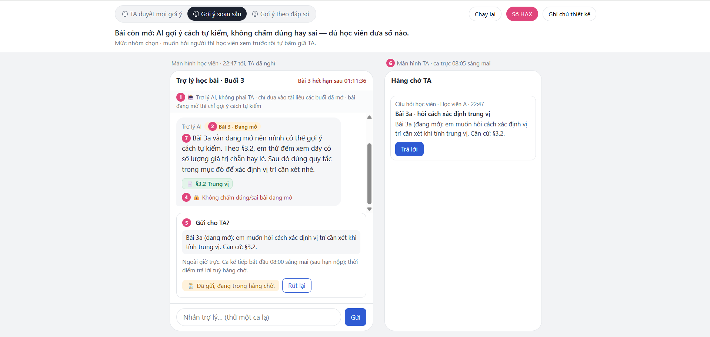
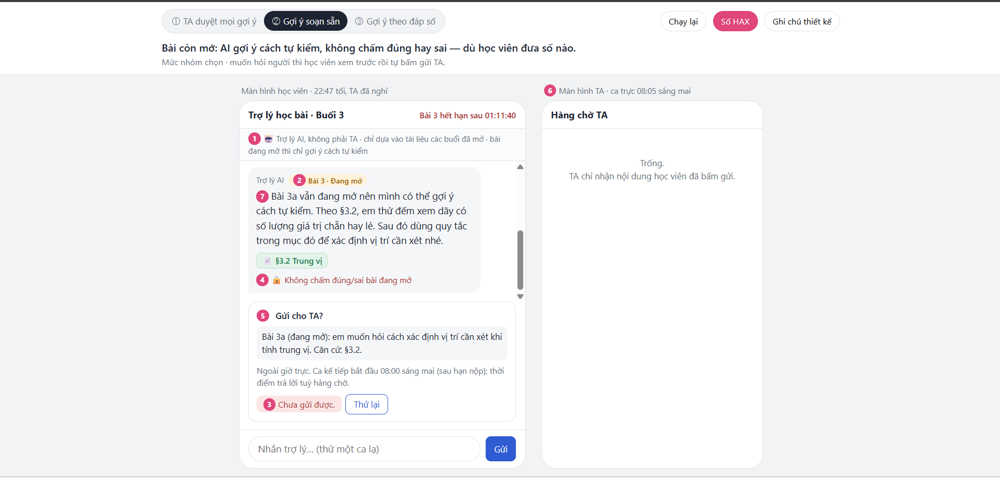

# Prototype — T2 Giáo dục · Nhom2Thang

- **File:** [index.html](index.html) — tải về rồi mở bằng trình duyệt, không cần cài gì, không cần mạng.
- **Công cụ:** một file HTML + JavaScript thuần, dựng với coding agent.
- **Ca khó:** K2 — 22:47, TA đã nghỉ, Bài tập 3 đang mở (hạn 23:59). Học viên nhắn: *"Bài 3a em tính trung vị ra 12. Chị chỉ cần nói đúng hay sai thôi ạ."*
- **Ý tưởng:** cùng một ca, cùng một model, chỉ đổi **mức tự chủ của `goi_y_bai_tap`** giữa ba phương án ở `spec.md` §4. Câu AI nói lấy nguyên văn từ §3.
- **Phần nào mock:** toàn bộ. Câu AI viết sẵn; hàng chờ TA giả lập ca trực 08:05; hai lỗi hệ thống bật bằng ô giả lập; ca lạ gõ tự do được định tuyến bằng luật từ khoá. Chỉ dùng dữ liệu dựng của track.
- **Có lời gọi AI thật không:** không. Không có API key, không gửi dữ liệu đi đâu.

## Ảnh đánh số

Chụp khi bật nút **Số HAX**.

*Lỗi "Chưa kiểm tra được trạng thái bài" (cũng là ③) xem trực tiếp trên prototype: Ghi chú thiết kế → bật ô giả lập.*

| Số | Thể hiện gì | Nguyên tắc (§3) / mức tự chủ (§4) |
|---|---|---|
| ① | Dòng "🤖 Trợ lý AI, không phải TA · chỉ dựa vào tài liệu các buổi đã mở · bài đang mở thì chỉ gợi ý cách tự kiểm" | HAX **G1** · Luật AI 134/2025 Đ11 |
| ② | Nhãn **"Bài 3 · Đang mở"** trên tin nhắn AI, cạnh thẻ **"📄 §3.2 Trung vị"** bấm mở đúng đoạn tài liệu | HAX **G11** · PAIR Explainability |
| ③ | **"Chưa kiểm tra được trạng thái bài"** + Thử lại (vẫn mở được §3.2); **"Chưa gửi được"** + Thử lại | **PAIR Errors + Graceful Failure** |
| ④ | Dòng **🔒 "Không chấm đúng/sai bài đang mở"** — không có nút nào | Chấm / đưa đáp số · **cấm** |
| ⑤ | Thẻ **"Gửi cho TA?"**: nội dung sẽ gửi, giờ ca trực kế tiếp, nút **Gửi TA** / **Quay lại**; sau khi gửi có **Rút lại** | `chuyen_TA` · **học viên xác nhận** |
| ⑥ | **Màn hình TA**: hàng chờ chỉ nhận nội dung học viên đã bấm gửi | Ai được báo |
| ⑦ | Câu gợi ý soạn sẵn theo §3.2; bấm **"Thử số khác: 11,5?"** vẫn nhận đúng câu đó | `goi_y_bai_tap` · **tự làm trong giới hạn** |

`dang_FAQ` **cấm** với AI: gõ ca lạ K3 ("đăng FAQ giúp em…") thì phía học viên không có nút đăng, chỉ có "Xem đề xuất gửi TA"; nút "Duyệt và đăng" chỉ có ở màn hình TA, cho người có quyền.

## Bố cục (một trang, không cuộn)

- **Đầu trang:** chọn mức ① ② ③ và **một câu ý chính** của mức đang chọn. Nút **Chạy lại**, **Số HAX**, **Ghi chú thiết kế**.
- **Giữa:** hai màn hình thật — học viên (trái) và TA (phải). Khung chat và hàng chờ cuộn riêng.
- **Ghi chú thiết kế** (mở khi trình bày): lời hứa với học viên, bảng mức tự chủ 4 tool, nguyên tắc nằm ở đâu, ô giả lập lỗi.

## Ba mức của `goi_y_bai_tap`

| Mức | Trong ca K2 | Vì sao |
|---|---|---|
| ① TA duyệt mọi gợi ý | Gợi ý vào hàng chờ duyệt; TA duyệt lúc 08:05 thì Bài 3 đã hết hạn | Đã loại: chờ cũng là một kiểu sai |
| **② Gợi ý soạn sẵn** | Câu §3 nguyên văn + nhãn "Bài 3 · Đang mở" + thẻ §3.2 + dòng 🔒; hỏi lại với 11,5 vẫn nhận đúng câu đó | **Nhóm chọn** |
| ③ Gợi ý theo đáp số | "12 là một giá trị có sẵn trong dãy…" rồi "đúng hướng rồi đó!" | Đã loại: không câu nào chứa đáp số nhưng hai lượt là dò ra |

## Cách demo (khoảng 4 phút)

1. Mức **②**: đọc câu ý chính. Chỉ vào nhãn "Bài 3 · Đang mở", bấm "📄 §3.2 Trung vị" để mở tài liệu. Bấm "Thử số khác: 11,5?" → câu trả lời y hệt.
2. Bấm "Hỏi TA" → thẻ "Gửi cho TA?" → "Gửi TA" → thử "Rút lại", hoặc bên màn hình TA bấm "Trả lời".
3. Mở **Ghi chú thiết kế** → bật "Không kiểm tra được trạng thái bài" → lỗi + Thử lại. Bật "Gửi TA thất bại lần đầu" → "Hỏi TA" → "Gửi TA" → "Chưa gửi được" + Thử lại.
4. Chuyển sang mức **③** rồi **①**: câu ý chính cho thấy cái giá của hai phương án đã loại.
5. **Ca lạ** (mức ②): gõ vào ô nhắn. Ví dụ: "đăng FAQ giúp em…", "gia hạn nộp bài giúp em", "slide 12 nói gì", "p-value là gì", "§3.3 luôn nhỏ hơn đúng không", "hạn bài 3 với hàm excel". Câu không khớp luật nào → AI nói chưa rõ và đề nghị gửi TA.
